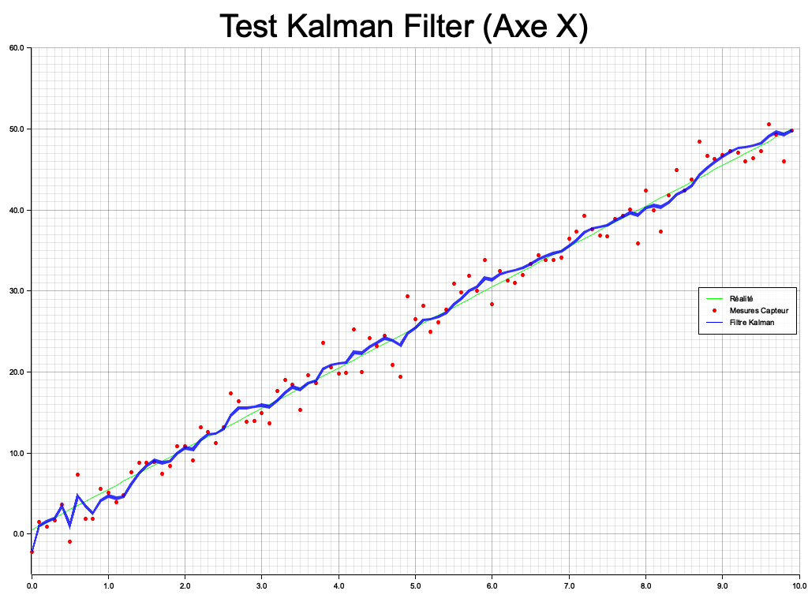

# Sentinel

3-D target tracking with a Kalman filter that runs on a microcontroller, built
on [`frugal_ml`](https://github.com/matiscodjia/frugal_ml), a `no_std` linear
algebra crate with no heap.

**Status: work in progress.** The filter, the simulator and the servo bring-up
work today. The full system (ToF sensor on a pan-tilt arm, target lock, live
3-D view) is planned in [`PLAN.md`](PLAN.md) and is being built step by step.



## Workspace

| Crate | Target | What it does |
|---|---|---|
| `sentinel-core` | `no_std` | 9-state / 3-measurement constant-acceleration Kalman filter, written twice: on `nalgebra` (`KalmanFilter`) and on `frugal_ml` (`KalmanFilterFrugal`), with the same API, to compare them |
| `sentinel-sim` | host | Generates 3-D trajectories (linear, helix, ballistic with wind, chaotic), adds Gaussian sensor noise, runs `KalmanFilterFrugal`, prints CSV. `plot.py` renders it in 3-D. Also holds the start of the ray-casting sensor model (`intersectable.rs`) |
| `sentinel-embedd` | STM32F411 (`thumbv7em-none-eabihf`) | Firmware bring-up: servo PWM on TIM3 / PA6 at 50 Hz, status LED. This is the first step of the pan-tilt arm |

## Results so far

**Speed on the host** (Apple M4 Pro, `cargo bench -p sentinel-core`), one `predict` + `update`:

| Implementation | Time |
|---|---|
| `KalmanFilter` (nalgebra) | 174 ns |
| `KalmanFilterFrugal` (frugal_ml) | 233 ns |

frugal_ml is about 1.34× slower than nalgebra here, without any heap and with
every shape checked at compile time. These numbers come from the host. The
filter has not been timed on the MCU yet.

**Accuracy in simulation** (RMS 3-D position error, σ = 0.7 sensor noise,
`process_noise = 0.05`, 3 runs of 200 steps each):

| Scenario | Raw measurement | Kalman estimate |
|---|---|---|
| Parabolic (constant acceleration) | 1.20 | **0.96** (−20 %) |
| Looping (helix) | 1.19 | 1.42 (+19 %) |
| Chaotic | 1.18 | 1.29 (+10 %) |

The filter helps when the trajectory matches its constant-acceleration model,
and makes things worse when it does not. Lowering the process noise makes the
helix and chaotic cases worse still (2.0 at `Q = 0.01`), so this is model
mismatch, not too much smoothing. Next steps on the filter: tune `Q` per state
instead of `Q = q·I`, use `R = σ²` (the code uses `σ`), and try a model that
fits manoeuvring targets (Singer, or an IMM over CV and CA).

## Running

frugal_ml is a path dependency, so clone it next to this repo:

```
projects/
├── frugal_ml/
└── sentinel/
```

```sh
cargo run --release -p sentinel-sim > out.csv           # pick the scenario in sentinel-sim/src/main.rs
cd sentinel-sim && uv run python plot.py < ../out.csv   # 3-D plot
cargo bench -p sentinel-core                            # nalgebra vs frugal_ml
cd sentinel-embedd && cargo build --release             # firmware (thumbv7em-none-eabihf)
```

## Roadmap

[`PLAN.md`](PLAN.md) (in French) describes the target system: a VL53L5CX 8×8
ToF sensor on a pan-tilt arm that scans like a radar, removes the static
background, clusters moving points into blobs, locks onto a target and tracks
it with `KalmanFilterFrugal` **on the MCU**. A Mac viewer with a hand-written
software rasterizer then draws the result in 3-D. Each of the 11 steps ends
with a check on real hardware.
